<div align="center">

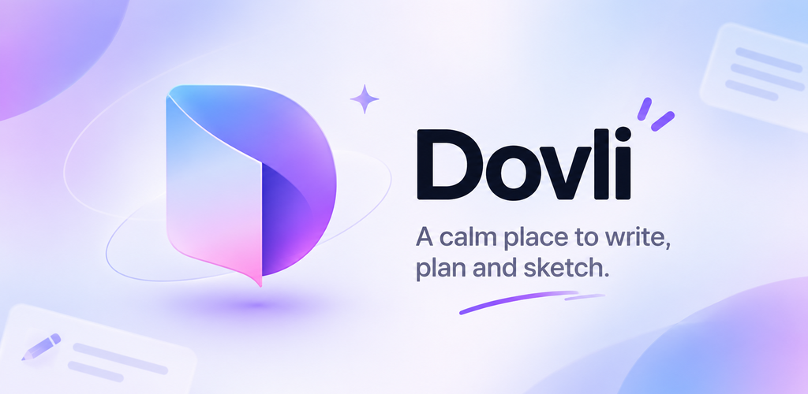

<h1>Dovli</h1>

<p><strong>A calm place to write, plan and sketch.</strong><br/>
Docs, to-dos and whiteboards in one workspace, on the web, on your phone and beside every website you read.</p>

<p>
  <a href="https://dovli.in"></a>
  
  <a href="https://chromewebstore.google.com/detail/eompomcfedlnlnbgbacbennoaehobodh"></a>
</p>

<p>
  <a href="https://dovli.in"><b>Open Dovli</b></a> ·
  <a href="#features">Features</a> ·
  <a href="#the-android-app">Android app</a> ·
  <a href="#dovli-for-chrome">Chrome extension</a> ·
  <a href="#connect-your-ai-apps">AI apps</a> ·
  <a href="#run-it-locally">Run it locally</a> ·
  <a href="docs/DEVELOPMENT.md">Developer guide</a>
</p>

</div>

---

## What is Dovli?

Dovli is a block-based notes app in the spirit of Craft and Notion, built to feel quiet and fast.
Write in pages made of blocks, nest pages inside each other, link them with `[[links]]`, sketch
on a whiteboard, and give every page its own look. Everything is saved on your device the moment
you type, so it works offline, then syncs across the web and your phone when you sign in.

## Where you can use it

| Platform | Status | Get it |
| --- | --- | --- |
| 🌐 **Web** | Live | [dovli.in](https://dovli.in) |
| 🤖 **Android** | In testing on Google Play | Public listing coming soon (`app.dovli`) |
| 🧩 **Chrome extension** | Live | [Chrome Web Store](https://chromewebstore.google.com/detail/eompomcfedlnlnbgbacbennoaehobodh) |
| 🤝 **AI apps (MCP)** | Live | Claude Desktop, Claude Code, Codex, Cursor and others ([how](#connect-your-ai-apps)) |
| 💻 **Mac & Windows** | In development | Works offline and syncs when you're back online ([build it](apps/desktop/README.md)) |
| 🍎 **iOS** | Planned | After the Android launch |

## Features

<table>
<tr>
<td width="50%" valign="top">

**✍️ Write**
- Block editor with `/` commands: headings, lists, to-dos, tables, toggles, callouts, quotes, code, pictures and files
- Nested pages, `[[links]]` and backlinks, `#tags`
- Text styles, colours, Focus and Box decorations
- Link previews and embeds
- Command palette (⌘K) to find and do anything

</td>
<td width="50%" valign="top">

**🎨 Make it yours**
- Four app themes: **Soft Studio**, **Frost**, **Night Desk** and **Mica**, or match your device
- Page styles with covers, icons, fonts, backdrop and paper colours
- Templates: meeting notes, project briefs, product specs, decision records, journals, brainstorm boards and more
- Present mode for reading a page full screen

</td>
</tr>
<tr>
<td valign="top">

**🧠 Think visually**
- Whiteboards for free-form sketching
- Flowcharts you can edit as diagrams
- All pages as cards, a grid or a list, each shown as a small picture of itself

</td>
<td valign="top">

**✨ AI writing help**
- Summarise, review, and rewrite selected text
- Turn any link into notes or a clean article
- **Dovli AI** is included free with a monthly allowance, or bring your own Groq, OpenRouter, Anthropic or OpenAI key
- Your pages are never used to train AI

</td>
</tr>
<tr>
<td valign="top">

**🔄 Sync and share**
- Offline first: saved on the device, synced when you're online
- Edits made offline on two devices are merged
- Invite people to a page as **Can view** or **Can edit**, or share a link

</td>
<td valign="top">

**📦 Your data, your way**
- Import from Notion, Evernote, Confluence, Craft, OneNote, Obsidian, Word and Markdown
- Export to PDF, Word, Markdown, image or a web page
- Export everything as a ZIP, plus automatic on-device backups
- Sign in with Google or a one-time email code: no passwords

</td>
</tr>
</table>

## The Android app

The same workspace in your pocket, with the same editor, themes and whiteboards, synced with the web.

<p align="center">
  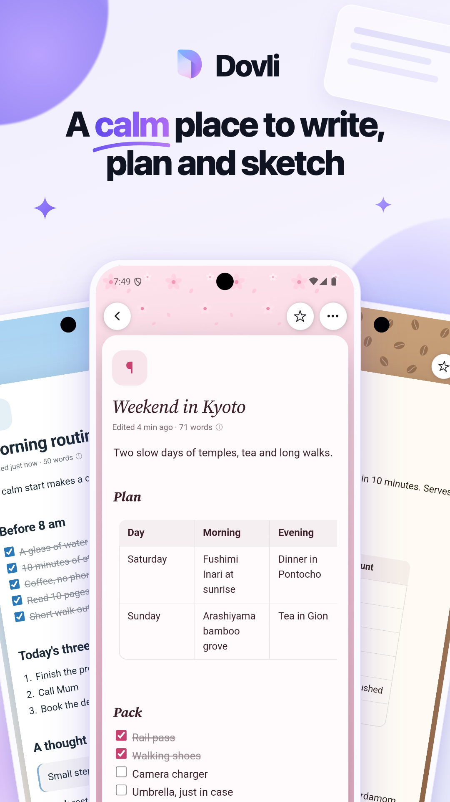
  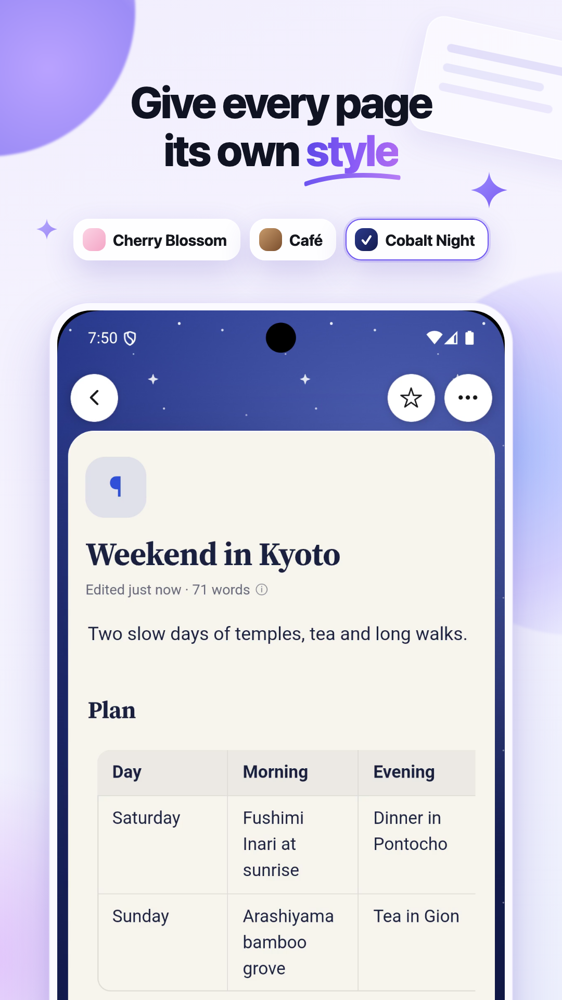
  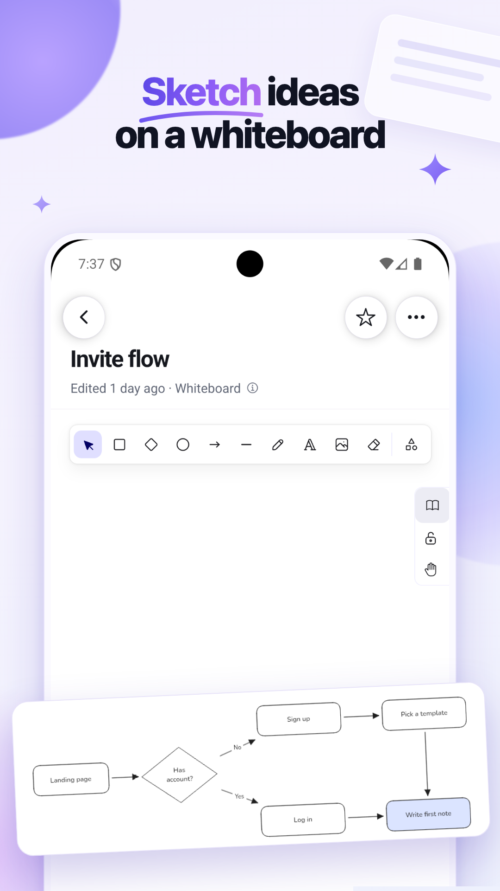
  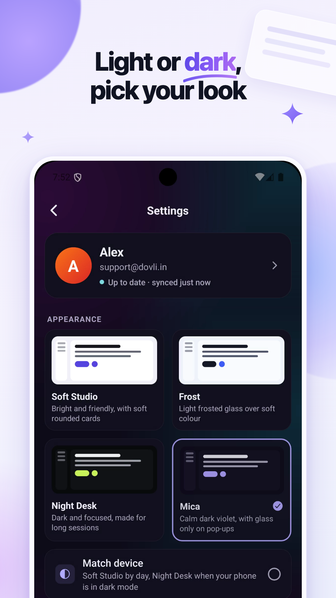
</p>
<p align="center">
  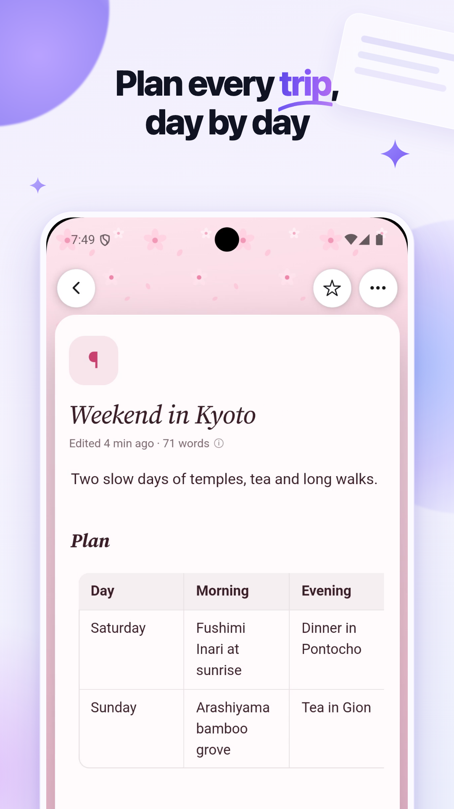
  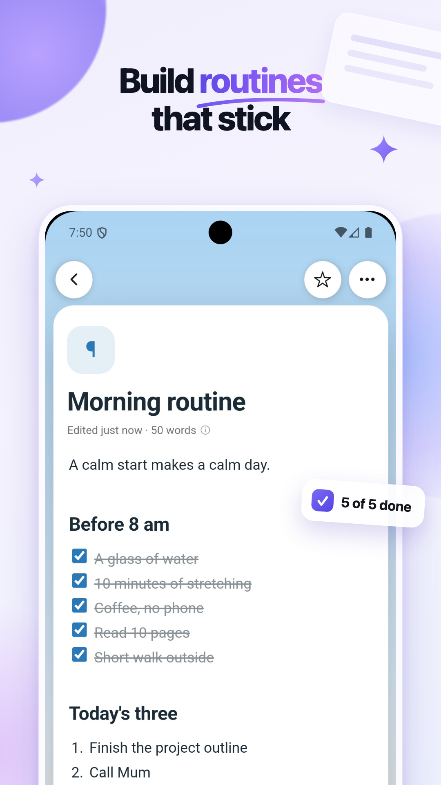
  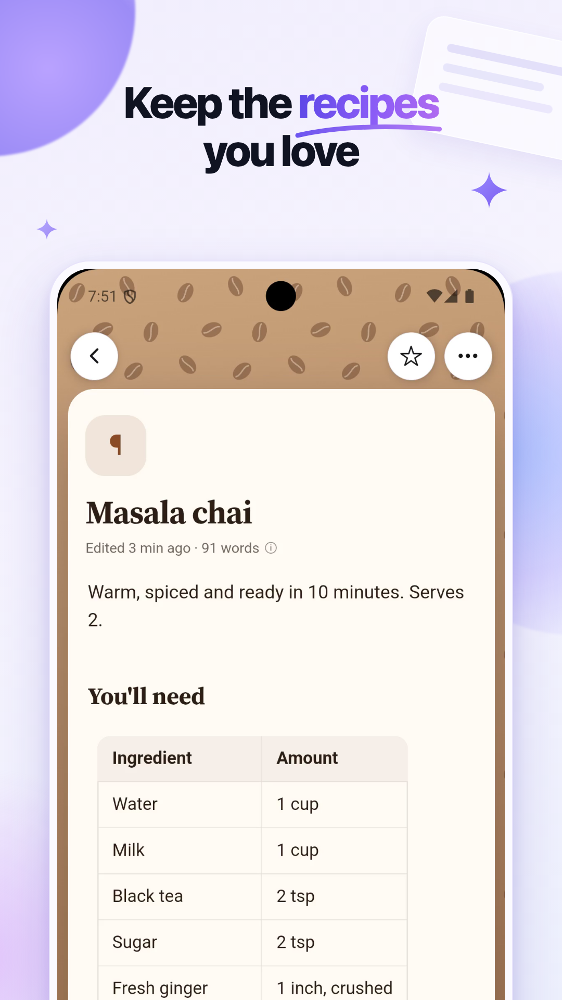
  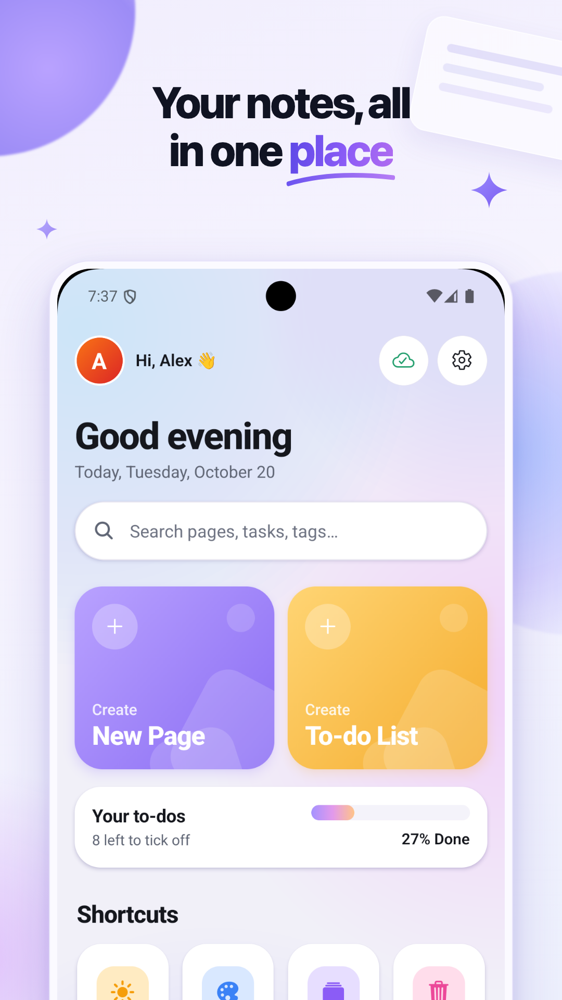
</p>

Built with Expo and React Native. The editor is the web editor running inside the app, so pages
look and behave the same everywhere. Source: [`apps/mobile`](apps/mobile).

## Dovli for Chrome

Clip the web, make AI notes, and keep a Dovli page open beside any website.
**[Add it to Chrome](https://chromewebstore.google.com/detail/eompomcfedlnlnbgbacbennoaehobodh)**, free on the Chrome Web Store.

<p align="center">
  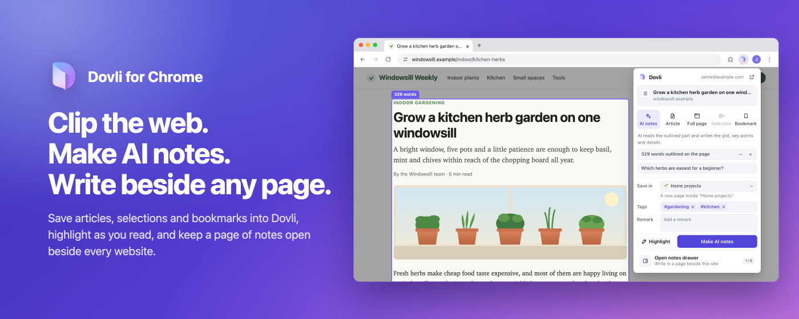
</p>

<table>
<tr>
<td width="50%">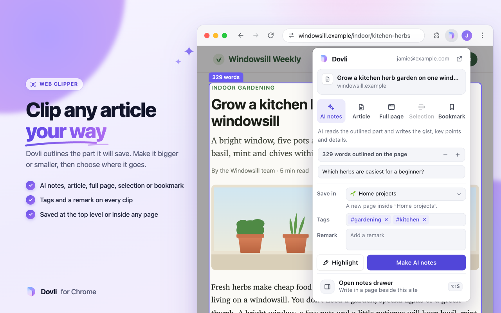</td>
<td width="50%">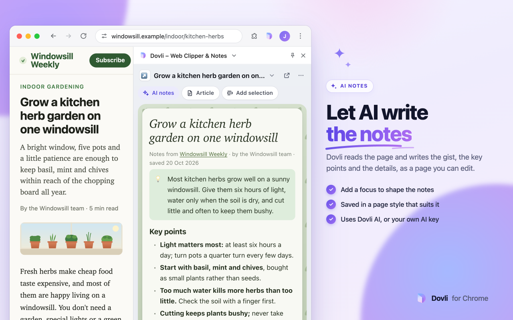</td>
</tr>
<tr>
<td width="50%">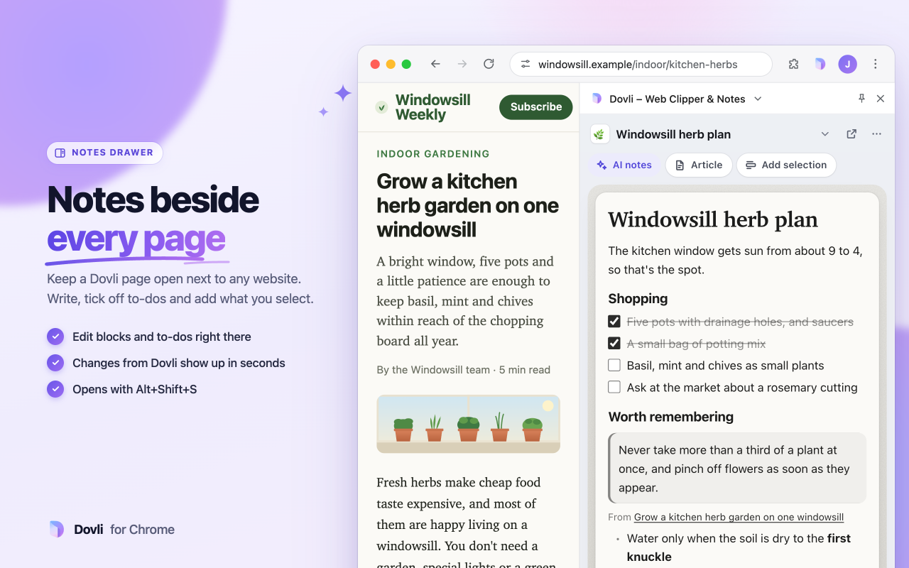</td>
<td width="50%">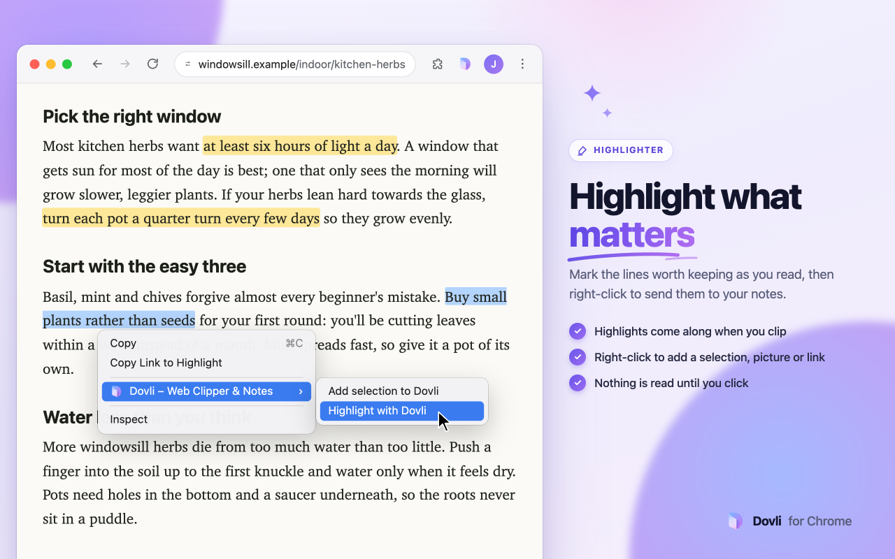</td>
</tr>
</table>

- **Clipper** (`Alt+Shift+D`): save a tab as AI notes, the article, the full page, your selection or a bookmark, with a title, tags and a remark
- **Highlighter**: mark what matters as you read; highlights come through in the clip
- **Notes drawer** (`Alt+Shift+S`): a Dovli page in Chrome's side panel, next to the website
- **Right-click**: add a selection, picture or link to your page in one click

Nothing is read from a website until you click. Details, permissions and privacy notes are in
[`apps/extension/README.md`](apps/extension/README.md).

### Run it from source

To try changes before they're on the Web Store, load it from this repo:

1. Open `chrome://extensions` and switch on **Developer mode**.
2. Click **Load unpacked** and choose the [`apps/extension`](apps/extension) folder.
3. Pin it from the puzzle-piece menu, open it, and click **Connect**.

## Connect your AI apps

Dovli speaks the [Model Context Protocol](https://modelcontextprotocol.io), so AI apps can read
and write your pages with your permission. Create a connection in **Settings → AI apps**, choose
which pages it can reach and whether it can edit, and paste the address into your AI app. For
apps that start MCP servers as a local command (Claude Desktop's settings file, older Codex), use
the small bridge in [`dovli-mcp.mjs`](dovli-mcp.mjs). Dovli serves it as an npm package, so
there's nothing to download:

```bash
npx -y https://dovli.in/dovli-mcp.tgz https://dovli.in/api/mcp/dvl_…
```

In Claude Desktop's `claude_desktop_config.json` that's
`{ "mcpServers": { "dovli": { "command": "npx", "args": ["-y", "https://dovli.in/dovli-mcp.tgz", "https://dovli.in/api/mcp/dvl_…"] } } }`
(Settings → AI apps shows it with your address filled in). `node dovli-mcp.mjs <address>` works too.

The address works however an app wants it: as the URL itself (more after it, like `/mcp`, is
fine), or `https://dovli.in/api/mcp` with the `dvl_…` key as `Authorization: Bearer dvl_…`,
`X-API-Key` or `?key=`. Open the address in a browser to check that it works. The bridge also
takes just the `dvl_…` key, or `DOVLI_MCP_URL` / `DOVLI_MCP_TOKEN` from the environment.

Your AI app can then search pages, read them, create pages, add and move blocks, and tick off
to-dos. You can switch a connection off or delete it at any time.

## Run it locally

You need **Node.js 20.19+**.

```bash
git clone https://github.com/MayankJha0333/dovli.git
cd dovli
corepack enable      # uses the pnpm version pinned in package.json
pnpm install
pnpm dev:web         # http://localhost:3000
```

That's enough to use Dovli on your own machine. Sign-in, sync and AI switch on when you add keys
to `apps/web/.env.local` (start from [`apps/web/.env.example`](apps/web/.env.example)).

| Command | What it does |
| --- | --- |
| `pnpm dev:web` | Web app at http://localhost:3000 |
| `pnpm dev:mobile` | Phone app (press `a` for Android, `i` for the iOS Simulator) |
| `pnpm typecheck` | Type-checks every app and package |
| `pnpm test` | Unit tests |
| `pnpm build` | Production build |

The **[developer guide](docs/DEVELOPMENT.md)** covers the rest: cloud setup (Firebase sign-in,
email codes, Firestore), AI keys, phone builds and Play Store releases with EAS, themes, and how
the layout and sync work.

## How it's built

| Layer | Technology |
| --- | --- |
| Web | [Next.js](https://nextjs.org) 16, React 19, Tailwind CSS 4, Radix UI |
| Phone | [Expo](https://expo.dev) 58, React Native, Expo Router, SQLite |
| Editor | [BlockNote](https://www.blocknotejs.org), shared by web and phone |
| Whiteboards | [Excalidraw](https://excalidraw.com) |
| Accounts and sync | Firebase Authentication, Firestore, IndexedDB on the device |
| AI | Groq (Dovli AI), or your own Groq, OpenRouter, Anthropic or OpenAI key |
| Extension | Plain Manifest V3, no build step |
| Monorepo | pnpm workspaces, Turborepo, Vitest |

```text
Dovli/
├─ apps/
│  ├─ web/          Next.js web app, API routes and landing site
│  ├─ mobile/       Expo (React Native) phone app
│  └─ extension/    Dovli for Chrome
├─ packages/
│  ├─ core/         page types, page tree, search, tags, links, three-way merge, templates
│  ├─ editor/       the block editor, shared by web and phone
│  ├─ sync/         the sync engine, shared by web and phone
│  ├─ theme/        app themes, page styles, covers, spacing
│  ├─ ui/           web UI kit (Radix + Tailwind)
│  └─ config/       shared TypeScript settings
├─ docs/            developer guide
└─ dovli-mcp.mjs    MCP bridge for AI apps
```

## Privacy

- Pages are saved on your device first and only leave it to sync with your own account.
- Your pages are never used to train AI.
- Dovli never sees a password: you sign in with Google or a one-time email code.
- You can export everything, or delete your account, at any time.

Read the full [privacy policy](https://dovli.in/privacy).

## Contact

Questions, ideas or bugs: open an [issue](https://github.com/MayankJha0333/dovli/issues) or
write to [support@dovli.in](mailto:support@dovli.in).

<div align="center">
<sub>Made with care by <a href="https://github.com/MayankJha0333">Mayank Jha</a>.</sub>
</div>
